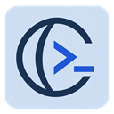
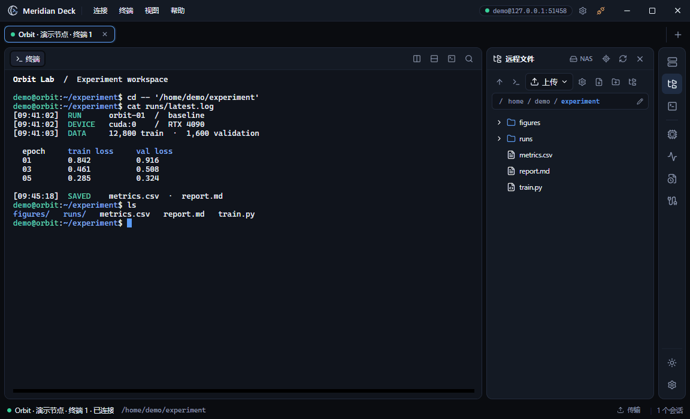

<p align="center">
  <picture>
    <source media="(prefers-color-scheme: dark)" srcset="assets/meridian-deck-icon-dark.png">
    
  </picture>
</p>

<h1 align="center">子午线 · Meridian Deck</h1>

<p align="center"><em>一线通山海</em></p>

<p align="center">
  面向服务器运维与科研计算的 SSH 桌面工作台
  <br>
  在同一窗口使用终端、管理远程文件、查看日志和监控 GPU。
</p>

<p align="center">
  <a href="#下载"><strong>下载</strong></a> ·
  <a href="#快速开始">快速开始</a> ·
  <a href="#主要功能">主要功能</a> ·
  <a href="https://github.com/LisonZhang0623/Meridian-Deck-Official/releases">版本说明</a> ·
  <a href="#本地开发">从源码构建</a> ·
  <a href="#文档与反馈">问题反馈</a>
</p>

## 工作台预览



动图使用本机回环 SSH 服务，实验文件和显卡指标均为演示数据。

## 下载

**1.0.0 正式版**支持拖出与收回文件预览、离线 Markdown 数学公式、交互网页和两套启动动画。可从下表下载安装包，或查看[正式版说明](https://github.com/LisonZhang0623/Meridian-Deck-Official/releases/tag/v1.0.0)。

| 平台 | 1.0.0 正式版 | 运行方式 |
| --- | --- | --- |
| Windows x64 | [Meridian-Deck-1.0.0-x64.exe](https://github.com/LisonZhang0623/Meridian-Deck-Official/releases/download/v1.0.0/Meridian-Deck-1.0.0-x64.exe) | 双击运行便携 EXE，需安装 [WebView2 Evergreen](https://developer.microsoft.com/microsoft-edge/webview2/) |
| macOS（Apple Silicon） | [Meridian-Deck-1.0.0-macos-arm64.zip](https://github.com/LisonZhang0623/Meridian-Deck-Official/releases/download/v1.0.0/Meridian-Deck-1.0.0-macos-arm64.zip) | 解压后打开 `Meridian Deck.app` |
| Linux x64 | [Meridian-Deck-1.0.0-linux-x64.tar.gz](https://github.com/LisonZhang0623/Meridian-Deck-Official/releases/download/v1.0.0/Meridian-Deck-1.0.0-linux-x64.tar.gz) | 解压后在包内目录运行 `./Meridian-Deck`，需要 GTK 4 和 WebKitGTK 6.0 |

在「帮助 → 检查更新」可直接查看[公开仓库的最新正式版](https://github.com/LisonZhang0623/Meridian-Deck-Official/releases/latest)。旧版用户可从上表手动下载本次重新构建的 v1.0.0。

## 快速开始

1. 启动 Meridian Deck，选择 **连接 → 新建 SSH 连接**。
2. 填写服务器地址、端口、用户名与认证信息，点击 **保存并连接**。首次连接时，核对主机密钥指纹后点击 **信任并继续**。
3. 在终端执行命令，或打开侧栏的 **文件** 面板，通过 SFTP 浏览、传输和编辑远程文件。

## 主要功能

- **SSH 终端**支持多标签、左右与上下分屏、输出查找和断线重连。可按名称接回远程 tmux 会话，通过 OSC 7 让文件树跟随终端目录。首次连接会检查目录上报，可在提示或设置中一键配置 Bash / Zsh。
- **连接管理**支持分组、标签和最近连接，可使用密码、私钥、SSH Agent 或交互认证，并配置多跳跳板和 SOCKS5 代理。
- **远程文件**支持 SFTP 拖拽上传、文件夹传输、暂停续传、目录对比和单向同步。可与系统已连接的 NAS 目录互传，也可使用独立的 FTP／显式 FTPS 面板。
- **编辑和预览**支持远程文本编辑、语法高亮和保存冲突检测。可分页查看大文本，分栏阅读带公式的 Markdown，运行 HTML 动画，查看 CSV／TSV 表格或对比两张图片。预览标签可拖出为独立窗口，再拖回工作台。
- **监控和日志**支持通过 `nvidia-smi` 查看 GPU 利用率、显存、温度和功耗，查看 Linux 的 CPU、内存、磁盘及网络状态，以及实时追踪远程日志。
- **命令和隧道**支持带参数的常用命令收藏，以及本地 TCP、远程 TCP、动态 SOCKS5、反向 SOCKS5 和本机 HTTP 代理共享。服务器配置和界面偏好可导入或导出为 JSON。

Windows 提供 DPAPI 凭据存储和原生文件拖出。macOS 与 Linux 使用系统保存对话框下载。

## 本地开发

安装 Go 1.27 或更高版本、Node.js 24 和 npm 11。Windows 使用 WebView2 Evergreen。Linux 构建需要 GTK 4、WebKitGTK 6.0、X11 开发库、C 编译器和 pkg-config。macOS 打包使用 Xcode 命令行工具。

```bash
git clone https://github.com/LisonZhang0623/Meridian-Deck-Official.git
cd Meridian-Deck-Official
npm ci
npm test
npm run build
```

桌面包生成在 `release/1.0.0/`。运行 `npm run dev` 可从源码启动。SSH 和 SFTP 集成测试在本机回环地址运行，测试会临时生成账号和密钥。

应用从 `main.go` 启动，Go 服务位于 `internal/`，Vue 界面位于 `src/renderer/`。旧 Electron 代码参与回归测试。构建参数和依赖版本见 `scripts/build.mjs`、`go.mod` 和 `package-lock.json`。

项目源码采用 [Apache License 2.0](LICENSE)。第三方依赖沿用各自的许可证。

## 文档与反馈

欢迎在 [GitHub Issues](https://github.com/LisonZhang0623/Meridian-Deck-Official/issues) 提交问题或功能建议。报告问题时，请附上操作系统及架构、应用版本、复现步骤和相关报错。分享日志或截图前，请移除服务器地址、账号、密码、私钥和令牌。
